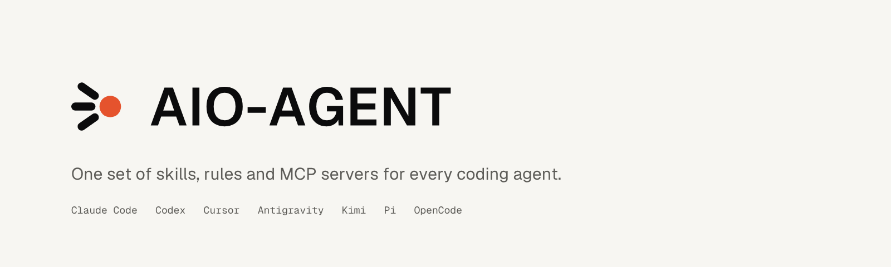

<picture>
  <source media="(prefers-color-scheme: dark)" srcset="assets/brand/banner-dark.png">
  
</picture>

# AIO-AGENT

[](https://github.com/wmasday/AIO-AGENT/actions/workflows/ci.yml)
[](https://github.com/wmasday/AIO-AGENT/releases)
[](LICENSE)

One set of skills, rules and MCP server definitions, installed once at user level for every coding agent on the machine.

AIO-AGENT draws on 17 open-source agent skills and tools (workflow, TDD, debugging, frontend quality, security, terse output), merged into 20 skills with one job each, and installs them into Claude Code, Codex, Cursor, Antigravity, Kimi, Pi, Oh My Pi and OpenCode. An always-on router of under 100 lines decides when each skill loads, so skill bodies stay out of the context until they are needed.

**Pre-release.** Tested end to end on macOS with Claude Code and Google Antigravity. Codex, Cursor, Kimi, Pi, Oh My Pi and OpenCode are tested at the config-file level only, because those agents were not available on the test machine. Linux and Windows have not been tested yet.

## Quick start

Requires Node.js 18 or newer (20.19 or newer for the Chrome DevTools MCP server).

```sh
npx aio-agent@latest install
npx aio-agent@latest doctor
```

`npx` downloads and runs the package's code. The installer backs up every existing file before changing it; see [what it writes](docs/installation.md#what-the-installer-writes).

From a clone instead, on macOS and Linux:

```sh
git clone https://github.com/wmasday/AIO-AGENT.git
AIO-AGENT/scripts/install.sh
AIO-AGENT/scripts/doctor.sh
```

Windows (PowerShell; not yet run on Windows, see [installation](docs/installation.md#windows)):

```powershell
git clone https://github.com/wmasday/AIO-AGENT.git
.\AIO-AGENT\scripts\install.ps1
.\AIO-AGENT\scripts\doctor.ps1
```

The installer configures only the agents it finds. Run it again at any time; a second run changes nothing. Optional API keys and every option are in [docs/configuration.md](docs/configuration.md).

## Skills

| Skill | Loads when |
| --- | --- |
| `aio-brainstorm` | You ask for a new feature: agrees a design before code |
| `aio-grill` | You ask to stress-test a plan: interviews you, keeps a glossary and ADRs |
| `aio-plan` | A design is agreed: writes small, verifiable tasks |
| `aio-execute` | You say to build the plan: works task by task |
| `aio-debug` | Something is broken: root cause before any fix |
| `aio-tdd` | Code is written for a feature or fix: red, green, refactor |
| `aio-verify` | Work is about to be called done: runs the proof |
| `aio-review` | A change needs review, or review comes back |
| `aio-lean` | Code is about to be written: smallest complete change |
| `aio-plain-output` | Docs, copy, commit messages or comments are written |
| `aio-frontend-design` | A UI is built or critiqued |
| `aio-modern-web` | Web platform APIs are chosen |
| `aio-ui-components` | You want a ready-made component (Magic MCP) |
| `aio-browser-debug` | A page needs debugging (Chrome DevTools MCP) |
| `aio-library-docs` | Code depends on a library's API (Context7 MCP) |
| `aio-security-review` | Code needs a security review (read-only) |
| `aio-pentest` | Only when you type `/aio-pentest` and confirm authorization |
| `aio-setup` | You ask how to set up an agent for a project |
| `aio-skill-check` | You want to install a third-party skill |
| `aio-terse` | You type `/terse` |

Agents load these on their own when the trigger matches. You can also call one by name, for example `/aio-tdd`. Details and sources: [docs/skills.md](docs/skills.md).

## Modes

| Command | Effect |
| --- | --- |
| `/terse` | Short answers; code, commands and warnings stay complete |
| `/prototype` | Skips brainstorming and TDD for throwaway code; replies are marked untested |
| `/normal` | Back to the defaults |

Safety rules hold in every mode. See [core/rules/precedence.md](core/rules/precedence.md).

## Platform support

| Agent | Rules | Skills | MCP | Tested |
| --- | --- | --- | --- | --- |
| Claude Code | yes | yes | yes | End to end on macOS: install, doctor, skill listing, workflow, Context7, DevTools and pentest-gate prompts |
| Google Antigravity | yes | yes | yes, without keys | On macOS: install, doctor, and the agent lists all 20 skills; workflow prompts not run |
| OpenAI Codex | yes | yes | yes | Config files only, macOS; agent not run |
| Cursor | paste by hand | yes | yes | Config files only, macOS; agent not run |
| Kimi Code CLI | no global file | yes | yes, without keys | Config files only, macOS; agent not run |
| Pi | yes | yes | yes | Config files only, macOS; agent not run |
| Oh My Pi | yes | yes | yes, without keys | Config files only, macOS; agent not run |
| OpenCode | yes | yes | no | Config files only, macOS; agent not run |

"Config files only" means the installer, doctor and uninstaller were run against a scratch home directory and the files were checked against each vendor's documentation, but the agent itself was not available to confirm it loads them. Linux and Windows are covered by the CI workflow, which has not yet completed a run. Paths and caveats per agent: [docs/platforms.md](docs/platforms.md).

## Update and uninstall

```sh
npx aio-agent@latest install     # update: rerun the latest version
npx aio-agent@latest uninstall   # remove everything and restore backed-up files
```

From a clone, use `scripts/update.sh` and `scripts/uninstall.sh` (`.ps1` on Windows). See [docs/updating.md](docs/updating.md).

## Documentation

- [Installation](docs/installation.md)
- [Configuration](docs/configuration.md)
- [Platforms](docs/platforms.md)
- [Skills](docs/skills.md)
- [Architecture](docs/architecture.md)
- [Troubleshooting](docs/troubleshooting.md)
- [Updating](docs/updating.md)

## Credits and license

AIO-AGENT is MIT licensed. It adapts work from the projects listed in [SOURCES.md](SOURCES.md); their licenses are in [THIRD_PARTY_NOTICES.md](THIRD_PARTY_NOTICES.md). Shannon, Strix, SkillSpector, Context7, Magic and Chrome DevTools MCP are not bundled: AIO-AGENT tells the agent how to run them.

Contributions: [CONTRIBUTING.md](CONTRIBUTING.md). Security reports: [SECURITY.md](SECURITY.md).
