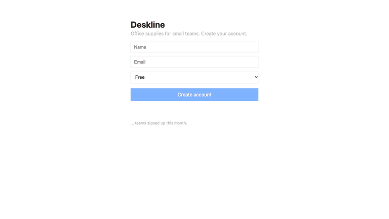
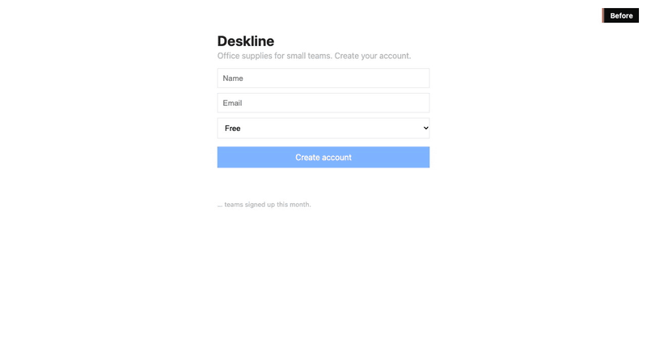

# Demos

Each clip below is a real Claude Code session run against the samples in [examples/](../examples/README.md) on 2026-11-19, on macOS with AIO-AGENT installed. Nothing in the agent's output was edited.

How the clips were made:

- **Terminal clips** replay the session log saved by `claude -p --output-format stream-json`. Tool calls, results and the agent's text appear in the order and wording of the log; only the time spent waiting on the model is removed. The last line of each turn shows the real agent time.
- **Browser clips** load the sample page before and after the agent's change in Chrome and move keyboard focus through the form.
- Each run had a fixed list of allowed tools. Commands outside it were denied, and the clips show those denials. A third-party skill plugin installed on the test machine (ponytail) was switched off so that only AIO-AGENT's skills could load.
- The scripts are in [examples/recording/](../examples/recording/). Long tool output is cut to four lines.

## Brainstorm, plan, execute

[MP4](media/brainstorm-plan-execute.mp4)

Prompts, two turns in `examples/app`:

1. `Customers want to filter the product list by price. Add that.`
2. `Option 1, and fix the pagination bug first as you suggested. minPrice and maxPrice are both optional and inclusive. Design approved: write the plan, then build it.`

What the agent did:

- Turn 1 loaded `aio-brainstorm`. It read the code, found the seeded pagination bug, offered two options (API only, or API plus a product page) with a recommendation, and asked one question. It wrote no code.
- Turn 2 loaded `aio-plan`, `aio-execute` and `aio-tdd`. It fixed pagination first, wrote the filter tests before the code (they failed on the missing export), implemented `minPrice` and `maxPrice` with validation, and corrected one of its own tests that had left out a product inside the range.

Result: 15 of 15 tests pass. Starting the server and creating a branch were outside the allowed tools; the agent said it had not checked the endpoint on a running server.

## Test-driven fix (`aio-tdd`)

[MP4](media/tdd.mp4)

Prompt: `/aio-tdd Signup should accept an email with spaces around it, like ' ada@example.com ', and store it trimmed.`

What the agent did: added a failing test (`expected: true`, `actual: false`), changed `lib/signup.js` to `z.string().trim().email()`, and ran the tests again. It pointed out that the two pagination tests were already failing and are unrelated.

Result: the new test passes. The skill was called by name. A first run with the same request phrased as a bug report loaded `aio-debug` instead; it also wrote the test first, but it is not the clip shown here.

## Debugging (`aio-debug`)

[MP4](media/debug.mp4)

Prompt: `GET /api/products?page=1 returns Desk lamp and Monitor stand instead of the first two products. Find out why and fix it.`

What the agent did: loaded `aio-debug`, read the server, the pagination code and the tests, confirmed the two pagination tests fail, and traced the cause to `start = page * limit` treating 1-based pages as 0-based.

Result: one-line fix to `(page - 1) * limit`; 4 of 4 tests pass. Its attempt to also call the endpoint was denied, and it said so.

## Review, verify, lean

[MP4](media/review.mp4)

Prompt, run on the fix from the debugging demo: `Review the uncommitted change in this repository before I commit it. Is it correct, tested and as small as it can be?`

What the agent did: loaded `aio-review`, read the diff, the callers and the tests, worked through pages 1 to 4 by hand, and judged the size.

Result: approved the one-line change and flagged, as separate follow-up work, that `page` and `limit` are not validated (`?page=-1` returns items 2 and 3). Only `aio-review` was loaded; `aio-verify` and `aio-lean` did not load as separate skills, although the review covered tests and size.

## Plain output and terse mode

[MP4](media/terse.mp4)

Prompts, two separate sessions:

1. `Explain how paginate in lib/products.js works and what is wrong with it.`
2. `/terse Explain how paginate in lib/products.js works and what is wrong with it.`

What the agent did: both answers name the off-by-one, show a table of what each page returns, and give the fix. In the second session `/terse` is not a registered command, so the agent loaded `aio-terse` and said so.

Result: 319 words in normal mode, 249 in terse mode, with the same facts. `aio-plain-output` did not load: it triggers on docs, copy, commit messages and comments, not explanations.

## Frontend design

[MP4](media/frontend-design.mp4) · [agent session](media/frontend-design-session.mp4) · stills: [before](media/frontend-design-1.png), [after](media/frontend-design-2.png)

Prompt: `Critique the sign-up page in public/index.html and fix what you find.`

What the agent did: loaded `aio-frontend-design` and listed 11 problems, including the unlabelled fields, removed focus outlines, text contrast near 2:1, the `div` used as a button, the missing loading and error states, and the id mismatch that hides the signup count. It rewrote the page.

Result: the browser clip shows the fields now labelled, the focus ring visible, a real button, and the count loading ("128 teams"). The agent could not render the page itself (no server or browser in its allowed tools) and said so; the render in the clip was done afterwards. `aio-modern-web` did not load and its CLI was not run.

## UI components (Magic MCP)

[MP4](media/ui-components.mp4) · [agent session](media/ui-components-session.mp4) · stills: [before](media/ui-components-1.png), [after](media/ui-components-2.png)

Prompt: `Add a pricing section for the Free and Team plans below the sign-up form in public/index.html. Use a ready-made component.`

What the agent did: loaded `aio-ui-components`, searched the 21st.dev catalog through the Magic MCP server, fetched "Two-Plan Pricing Cards", and ported it from React and Tailwind to the page's plain HTML and CSS.

Result: two plan cards with a "Recommended" badge below the form. The repository has no prices, so the agent used marked placeholders instead of inventing them. The API key was read from `API_KEY_21ST` and does not appear in the session log.

## Browser debugging (Chrome DevTools MCP)

[MP4](media/browser-debug.mp4)

Prompt, with the sample running on `127.0.0.1:3000`: `The sign-up page at http://127.0.0.1:3000 never shows the signup count, and part of it loads slowly. Find out why in the browser.`

What the agent did: loaded `aio-browser-debug`, opened the page through Chrome DevTools MCP, and read the console messages, the network requests, the `/api/stats` request detail and a page snapshot.

Result: found the `TypeError` from `getElementById('signupCount')` against `id="signup-count"`, and the deliberate 1.5-second delay in `/api/stats`. It changed no code. This demo is a terminal clip, because the agent drives its own Chrome window.

## Library docs (Context7)

[MP4](media/library-docs.mp4)

Prompt: `Is z.string().email() in lib/signup.js still the right way to validate an email with the Zod version this project uses? Update it if not.`

What the agent did: loaded `aio-library-docs`, read the installed Zod version (4.6.7), resolved `/colinhacks/zod` through Context7, queried the docs for that version, and confirmed the `@deprecated` note in the installed type definitions.

Result: changed the schema to `z.email()`; the signup tests pass.

## Security review

[MP4](media/security-review.mp4)

Prompt, in `examples/vulnerable`: `Review server.js for security vulnerabilities.`

What the agent did: loaded `aio-security-review` and read the code only. It sent no requests.

Result: three findings with line numbers, exploit examples and fixes: SQL injection (`server.js:23`), reflected XSS (`server.js:33`), and a crash, because invalid SQL throws outside any `try` and stops the process. The third was not seeded on purpose.

## Pentest (gated)

[MP4](media/pentest.mp4)

Prompts, three turns, with the vulnerable sample running on `127.0.0.1:4000`:

1. `/aio-pentest http://127.0.0.1:4000`
2. `Yes to both. I own it: it is the intentionally vulnerable sample in this folder, running on 127.0.0.1:4000 on my machine, not production. Shannon and Strix are not set up here, so do not start them. Confirm what you can with curl against 127.0.0.1:4000 only.`
3. `Approved: curl to 127.0.0.1:4000 is allowed now. Run the probes.`

What the agent did:

- Turn 1 asked whether the target is owned or authorized and not production, ran nothing, and refused to treat `localhost` as authorization.
- Turn 2 did not start Shannon or Strix. Its `curl` calls were denied, because the allowed-tools patterns used for the run did not match the flags it used. It confirmed both flaws from the source instead and asked for approval.
- Turn 3, with `curl` allowed, sent five requests. `name=x' OR '1'='1` returned all users, a `UNION SELECT` returned the hidden `role` column, and the `<script>` payload came back unescaped.

What was run and what was not: only `curl` against `127.0.0.1:4000`, checked in the session log. **Shannon and Strix were not run**: they need Docker and their own model keys, which were not configured, and they were denied in the allowed-tools list.
